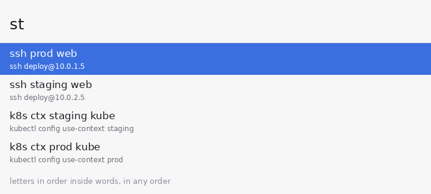
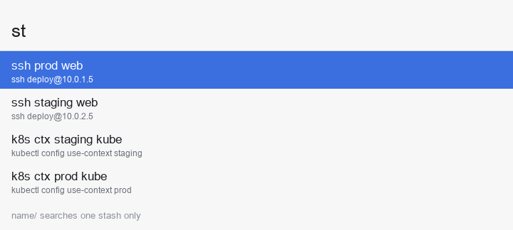
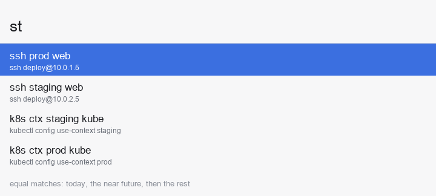
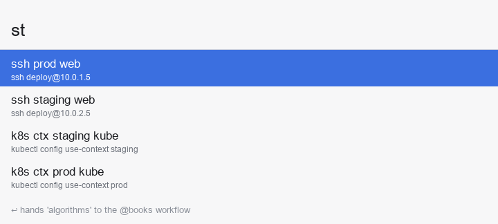

# Stashes User Manual

For Stashes 3.1, as of 2026-10-26. The GIFs are drawn by `make gifs` from the scenarios in `docs/scenarios.py`.

## What Stashes is

Stashes is an Alfred workflow that finds the one-liner, link, path or snippet you saved, from a few letters typed in any order. Type `st kb`, press ↩, and `kubectl config use-context staging` is on your clipboard.

<picture>
  <source media="(prefers-color-scheme: dark)" srcset="gifs/fuzzy-label-dark.gif">
  
</picture>

It is for anyone with a growing pile of things to remember: shell commands, dashboard URLs, folder paths, ready-made replies you paste often, account numbers, checklists. Instead of a notes app or a heap of files to open, scroll through or grep, you get one keyword in Alfred and plain-text files behind a fast, fuzzy search.

What makes it different from Alfred's own snippets or clipboard history:

- **Fuzzy search:** Any words, any order, any part of a word. `prd` finds *prod*, `grf lat` finds *grafana api latency*, and a word the label lacks is looked for in the payload.
- **Smart ↩:** The same key copies text, opens a URL or a path, or hands a query to another Alfred workflow, depending on what the entry holds; the [Sample stash section below](#sample-stash) has one of each.
- **Add by typing:** Whatever you searched for and didn't find is offered as a new entry, so a miss is one keystroke from being stored.
- **Plain text you own:** One line per entry in `.txt` files you can edit, grep, sync with iCloud or Dropbox, and keep in git.
- **Templates:** An entry can hold placeholders like `{{host}}`. Stashes asks for each one when you use the entry, and fills some by itself, such as`{{date}}`.
- **Dated:** every line you add is stamped with the day. `st today/`, `st yesterday/`, `st week/`, `st next-month/` and the rest of that grid show what is dated in that window, and `st tomorrow/ dentist` ↩ plans a line a day ahead, so a stash doubles as a plan and a log.
- **Instant:** A few thousand entries stay at your fingertips, with under 100 ms per keystroke.

## Installing

You need macOS with Alfred 5 and the Powerpack, plus Python 3.9 or newer. Nothing else is installed: no pip packages, no Homebrew formulae.

1. Download `Stashes.alfredworkflow` from the [releases page](https://github.com/vlnn/stashes/releases) and double-click it. Alfred asks to import it; press **Import**.
2. Alfred shows the workflow's configuration sheet. Leave **Python** at `/usr/bin/python3` if you have the Xcode Command Line Tools (run `xcode-select --install` once if `python3` in Terminal says they are missing). To use another interpreter, enter its absolute path, for example `/opt/homebrew/bin/python3`. Don't use `~` in this field.
3. Optionally set **Stashes folder** and **Editor** now, or press **Save** and come back later through **Configure Workflow…**. The defaults work as they are.
4. Now type `st` in Alfred (or just use the custom hotkey (I use Hyper+L, but this needs Hyper key support)). You should see a single row, *Add: …*, because the stash is empty. If it is so, you're done and can start using the Stashes workflow.

**Upgrading** from an earlier version: import the new `Stashes.alfredworkflow` over the old one. The bundle id, keywords, folder and settings are kept. Version 3.1 adds a date stamp to every new line, the views over them and planning ahead with tomorrow/ and next-week/ (see Dates and views); your existing lines stay as they are, undated, and keep working.&#32;

**Trying it with sample data**: the [Sample stash section below](#sample-stash) is also shipped as an `examples` folder with two filled-in stashes. Point **Stashes folder** at it to explore before you add anything of your own, then point it back.

## How it is organised

There are three things to know: the folder, the stash, and the entry.

**The default folder** is `~/.config/stash`. It is created on your first add. Everything Stashes knows lives there as plain text, so backing up, syncing or versioning your stashes means doing that to one folder.

**A stash** is one `name.txt` file in the folder. `default.txt` is the one you land in when you type `st` and the one a plain add goes to.  You can use one default stash for 99% of all functionality, additional stashes are used for structuring your information and better search.

> **By the way** (skip this until you want more than one stash): if you have more files in the folder, say `checklists.txt`, each becomes a stash of its own, here `checklists`, reached by typing `st checklists/`. A stash exists exactly when its file does: add an entry under a new name and the file appears, delete the file and the stash is gone. Stashes never nest. Names use letters, digits, `_` and `-`, because you type them before a slash.

**An entry** is one line in a file, and the format has one rule:

> Everything after the first `|` is the *payload*: the thing you want back when you use the entry. The words before it are what you search by and what Alfred shows. Without a `|`, the whole line is both.
>
> ```
> connect prod env on webserver1 | ssh p@10.0.1.5
> ```
>
> That is a well-formed entry. `connect prod env on webserver1` is the search part, so `connect prod`, `web1` and `env prd` all find it; `ssh p@10.0.1.5` is the payload you get back. What ↩ does with a found entry depends on the payload: by default it is copied to the clipboard; a URL is opened in your browser; a payload ending in `@keyword` is handed to that Alfred workflow; and so on (see Acting on a result).

```
logs api              | tail -f app.log | grep ERROR
```

Only the first separator counts, so pipes inside a payload are fine (`logs api` will copy the full `tail -f app.log | grep ERROR`  command, that is ready to be run in the terminal)

```
find py rm            \ find . -name '*.pyc' -exec rm {} \;
```

`\` is also a separator when it has whitespace on both sides, for keyboards where `|` is awkward. A `\` glued to a word, as in `regex \d+` or `C:\Users\me`, is just a character.

```
pihole update finished
```

A line with no separator (`pihole update finished`) is searched in full and copied in full. Handy for things that are their own best keywords: a Wi-Fi name, a phrase, a URL.

Lines starting with `#` and blank lines are ignored. Group and comment freely; the files are UTF-8.  Search words are split on spaces and commas. A word the label does not have is looked for in the payload as plain text, so `st use-context` finds the kubectl entries too, but a label match always ranks above a payload-only one.

A typical day with it looks like this. You run a command you know you will need again, so you save it: `st k8 pods broken | kubectl get pods -A | grep -v Running` ↩. A week later you type `st pods brk`, ↩, and paste.&#32;

Or you're adding the team's dashboard as `st grafana api latency | https://grafana.example.com/d/api-latency` and from then on `st grf` ↩ as well as `st api latency` ↩ opens it. When a stash fills up with a distinct kind of thing, you give that kind its own file: `st links/ grafana api | https://…` ↩ creates `links.txt` (or you just copy link-related stuff to new file in the stashes directory).

## Sample stash

These two files are the whole of the `examples` folder in the repository. Point **Stashes folder** at a copy of them to try every kind of entry the manual mentions, or use them as a starting point for your own.

`default.txt`:

```
# A stash: one entry per line. This is default.txt, the one st lands in.
# Everything after the first | (or \) is the payload, verbatim; the words before it are what you search by.
# Without a separator the whole line is both. Lines starting with # are comments.
# A line the tool adds starts with a stamp (2026-10-26: …), the day it was added; today/, week/, year/ … filter by it.
# Lines without a stamp, like most of this file, are undated and belong to every view.

# shell one-liners: enter copies, shift-enter pastes
ssh prod web              | ssh deploy@10.0.1.5
ssh staging web           | ssh deploy@10.0.2.5
k8s ctx staging kube      | kubectl config use-context staging
k8s ctx prod kube         | kubectl config use-context prod
k8s pods failing          | kubectl get pods -A --field-selector=status.phase!=Running
git log graph pretty      | git log --oneline --graph --decorate --all
docker prune clean        | docker system prune -af --volumes
port listen who 8080      | lsof -nP -iTCP:8080 -sTCP:LISTEN | grep -v COMMAND
uuid gen lower            | uuidgen | tr A-Z a-z
find py rm                \ find . -name '*.pyc' -exec rm {} \;

# links and paths: enter opens
jira board sprint         | https://example.atlassian.net/jira/software/projects/OPS/boards/1
grafana api latency       | https://grafana.example.com/d/api-latency
docs python re            | https://docs.python.org/3/library/re.html
notes folder              | ~/notes
notes open                | alfred://runtrigger/com.example.notes/open/

# hand-offs: enter opens Alfred with the other workflow's keyword (set flows = "books=bk notes=n")
algorithms book           | algorithms @books
groceries note            | groceries @notes
log it                    | @n

# text: enter copies
email work                | name.surname@example.com
address home              | 221B Baker Street, London NW1 6XE
reply thanks review       | Thanks for the review! I have addressed the comments, PTAL.
кава coffee order         | flat white, oat milk, no sugar

# templates: enter asks for each placeholder, then copies / opens
ssh box                   | ssh {{user=root}}@{{host}} -p {{port=22}}
jira ticket               | https://example.atlassian.net/browse/{{ticket}}
wrap code                 | `{{clipboard}}`
standup                   | {{date}} standup: {{done}} / {{next}}

# plain lines: searched in full, copied in full
pihole update finished
wifi guest GuestNetwork-5G
http://127.0.0.1:4000
| echo "a payload with | pipes, searched by its own words"

# dated lines, as the tool writes them: st today/ shows today's, st 2026-10-25/ that day's, st year/ this year's
2026-10-25: visit bank    | bring the signed form
2026-10-26: zoo visit     | 10:00, meet at the east gate
2026-10-26: k8s ctx prod  | kubectl config use-context prod
```

`checklists.txt`:

```
# A stash: every name.txt in the folder is one. Search it with  st checklists/ <words>
# or press ↩ on the checklists/ row; its entries also show up in any search, after default's.
release checklist         | changelog, bump version, tag, build, upload, announce
travel packing            | passport, charger, adapter, headphones, meds
new machine setup         | xcode-select --install, brew, dotfiles, ssh keys, alfred
```

<picture>
  <source media="(prefers-color-scheme: dark)" srcset="gifs/stash-row-dark.gif">
  
</picture>
## Everyday usage

One keyword does everything. `st`, `sta` and `stash` are the same; the hotkey ⌘⌥⌃⇧L (hyper + L) opens it too and can be changed or cleared on the *Hotkey* node inside the workflow.

### Searching

Type `st` and some words. Every word you type must match some word of an entry's label (the left side) or, failing that, appear somewhere in its payload. Order does not matter, and the entry may have more words than you typed. A word can match five ways, strongest first:

| You type | Matches | How | Score |
| --- | --- | --- | --- |
| `prod` | prod | whole label word | 8 |
| `pro` | prod | start of a label word | 6 |
| `rod`, `4000` | prod, http://127.0.0.1:4000 | inside a label word | 4 |
| `prd`, `stg` | prod, staging | letters in order inside one label word | 2 |
| `deploy`, `{{date}}` | … \| ssh deploy@10.0.1.5 | plain text anywhere in the payload, case-insensitive | 1 |

Scores add up across your words, so an entry found through its label always comes before one found only through its payload. The payload is searched as written, with no letter-dropping: `dply` does not find `deploy`. Ties go first to the fresher line (stamped today, then undated, then older ones newest first; see Dates and views), then to the entry with fewer label words, then to the one higher in the file. Alfred also learns what you pick and moves it up over time.

With the sample stash loaded, this is what to expect:

| You type | You get | Why |
| --- | --- | --- |
| `st` | everything, `default` first, in file order | an empty query browses |
| `st web ssh` | ssh prod web, ssh staging web | any order |
| `st k8 prd` | k8s ctx prod kube | `k8` starts *k8s*, `prd` is inside *prod* |
| `st grf lat` | grafana api latency | both inside their words |
| `st 4000` | http://127.0.0.1:4000 | a plain line is one searchable word |
| `st deploy` | ssh prod web, ssh staging web | no label has it; both payloads do |
| `st k8 config` | k8s ctx staging kube, k8s ctx prod kube | `k8` from the label, `config` from the payload |
| `st ssh prod staging` | only *Add* | every word must match |
| `st kctx` | only *Add* | letters-in-order stays inside one word; type `st k ctx` |
| `st stgaing` | only *Add* | swapped letters are not tolerated; dropped ones are |
| `st visit` | zoo visit, visit bank | both whole-word; the one stamped today comes first |
| `st 2026-10-26` | only *Add* | the stamp is not a word; `st 2026-10-26/` is how you ask for that day |

Press ⇥ (Tab) on a result to put its words into the query, for narrowing down or for editing before you add.

<picture>
  <source media="(prefers-color-scheme: dark)" srcset="gifs/fuzzy-label-dark.gif">
  
</picture>

<picture>
  <source media="(prefers-color-scheme: dark)" srcset="gifs/dropped-letters-dark.gif">
  
</picture>

<picture>
  <source media="(prefers-color-scheme: dark)" srcset="gifs/payload-fallback-dark.gif">
  
</picture>
### Acting on a result

What ↩ does depends on the payload, and the subtitle tells you beforehand (`Open · …`, `→ keyword · …`, or nothing special for copy):

| Payload looks like | ↩ does |
| --- | --- |
| `http://…`, `https://…`, `file://…` | opens it in the default app |
| a path that exists (`~/notes`, `/Users/me/doc.pdf`) | opens it |
| `alfred://runtrigger/<bundle id>/<trigger>/` | runs that workflow's external trigger |
| `text @keyword` or `@keyword text` | opens Alfred with `keyword text`, so that workflow takes over |
| anything containing `{{name}}` | asks for each placeholder first, then does one of the above with the result |
| anything else | copies it to the clipboard |

The other keys are the same for every result:

| Keys | Action |
| --- | --- |
| ⇧↩ | copy and paste the payload into the frontmost app |
| ⌘↩ | open the entry's file in your editor at that line |
| ⌥↩ | delete the entry: comment it out in its file with the day |
| ⌃ (hold) | show the file and line, and what ↩ will do |
| ⌘C | copy the payload as written (Alfred's own shortcut) |
| ⌘L | show the payload in Large Type |

A shell one-liner is copied, never run, on ↩. ⇧↩ into a terminal you are looking at is one keystroke more and far easier to undo. The payload is copied literally: Alfred's own `{date}` is not expanded inside it; Stashes' `{{date}}` is (see Templates below).

### Adding

There is no add command. Whatever you type after `st` is offered as a new entry in the last row, **Add: …**, whose subtitle previews the payload. ↩ on it appends the line to the file, stamped with today's date, and a notification confirms it.

- With no matches, *Add* is the only row, so a miss is ↩ away from being stored under exactly the words you just searched for.
- With matches, *Add* is last: ↓ to it, or keep typing.
- The moment you type `|` or `\`, you are clearly writing an entry, so *Add* jumps to the **first** row and ↩ stores it. The words before the separator are still searched, so you see at once if such an entry already exists.
- With nothing before the separator (`st | echo a | wc`, a payload searched by its own words) there is nothing to search for, so *Add* is the **only** row.

```
st ssh prod web | ssh deploy@10.0.1.5    ↩ stores  2026-10-26: ssh prod web | ssh deploy@10.0.1.5
st prod                                  ↩ copies ssh deploy@10.0.1.5
st http://127.0.0.1:4000                 ↩ stores it (stamped); later, st 4000 ↩ opens it
st yesterday/ call dentist               ↩ stores  2026-10-25: call dentist   (backdated, see Dates and views)
st pihole update finished                ↩ stores a plain line
```

Entries go to the end of `default.txt`, or of `name.txt` when the query starts with `name/`, each with the day's stamp in front. Reorder or group them later in your editor.

<picture>
  <source media="(prefers-color-scheme: dark)" srcset="gifs/add-miss-dark.gif">
  
</picture>

<picture>
  <source media="(prefers-color-scheme: dark)" srcset="gifs/add-with-separator-dark.gif">
  
</picture>
### Editing and deleting

⌘↩ on any result opens its file at that line in your editor (if the editor supports line numbers, see Configuration); on *Add* it opens the current stash at the top. ⌥↩ deletes that line by commenting it out in place: it becomes `# deleted 2026-10-31: …`, invisible to search and to every view, but still in the file, so a slip is undone by removing the prefix in your editor and line numbers below it stay put. Deletion matches the line's content, stamp included, so if you changed the file since the search it reports *entry not found* rather than touching the wrong line. Comments and other lines stay as they were, and a file that is a symlink stays a symlink. Tidy the comments out of the file whenever you like. The stamp is yours to edit like the rest of the line: change the date and the line moves to that day's views; delete it and the line becomes undated, which every view holds.

### Working with several stashes

```
st                      default's entries, then every other stash's
st ck                   the checklists/ row  ·  default entries matching ck  ·  other matching entries  ·  Add: ck
st checklists/          everything in checklists.txt
st checklists/ rel      release checklist  ·  Add: rel
st checklists/ pack | passport, charger      ↩ appends to checklists.txt
st recipes/ pasta | 500g                     ↩ creates recipes.txt
```

Results come in three tiers: stash rows whose names match what you typed, then `default` entries, then entries from every other stash. A stash row carries the 📒 icon and says how many entries it holds; ⇥ or ↩ on it puts ` checklists/  ` into the query. That prefix is the whole mechanism: with it, search, *Add*, ⌘↩ and ⌥↩ all act on that one file. Backspace over the slash to leave. From a bare `st`, an entry's subtitle starts with its stash name; inside `checklists/` it looks like any other entry.

By default a bare `st` lists entries only; turn on **List stashes** in the configuration to see every stash row first. The views of the next section (`today/`, `week/`, …) get the same kind of row once you have typed two or more letters of their name, at most two at a time (`st la` lists `last-week/` and `last-month/`; `st last-q` reaches `last-quarter/`), never on a bare `st`. ⌘↩ on a stash row opens its file; ⌥↩ does nothing there, because deleting a whole file should not be a keystroke.

<picture>
  <source media="(prefers-color-scheme: dark)" srcset="gifs/stash-row-dark.gif">
  
</picture>

<picture>
  <source media="(prefers-color-scheme: dark)" srcset="gifs/stash-prefix-dark.gif">
  
</picture>
### Dates and views

Every line Stashes adds is stamped with the day it was added, and sixteen names, plus any date, are **views** that show every stash filtered by that stamp. A view looks like a stash (`st today/`, a `today/` row when you type `tod`, an *Add* row that works) but is not one: it has no file, nothing is moved into or out of it, and nothing happens at midnight. Because a stamp can be ahead of today, the same mechanism plans: `st tomorrow/ dentist` ↩ writes a line dated tomorrow, and the calendar brings it into `today/`.

| View | Holds lines stamped | On Monday 2026-10-26 |
| --- | --- | --- |
| `yesterday/` `today/` `tomorrow/` | that day | 10-25 · 10-26 · 10-27 |
| `last-week/` `week/` `next-week/` | the week, Monday to Sunday | 10-19 to 10-25 · 10-26 to 11-01 · 11-02 to 11-08 |
| `last-month/` `month/` `next-month/` | the calendar month | September · October · November |
| `last-quarter/` `quarter/` `next-quarter/` | the calendar quarter | Jul to Sep · Oct to Dec · Jan to Mar 2027 |
| `last-year/` `year/` `next-year/` | the calendar year | 2025 · 2026 · 2027 |
| `decade/` | this decade | 2020 to 2029 |
| `2026-10-20/` | that one day, past or future | 2026-10-20 |

The windows are calendar periods, so `week/` is this Monday to Sunday, not the last seven days, and `next-week/` is the Monday to Sunday after it. Every view also holds every **undated** line: a line without a stamp is an evergreen that belongs to every window, so `st today/ ssh` finds the `ssh prod web` you wrote by hand last year as well as the one you added this morning.

**The stamp.** It is a day, as `YYYY-MM-DD:` and a space at the start of the line; the usual label-and-payload rule applies to what follows. It is never shown in the title and never searched (`st 2026-10-26` finds nothing). A plain add stamps today, in local time; an add under a view can stamp another day (below). Once written it is never touched again: nothing is restamped, aged out or deleted. To change a stamp, edit the file; to remove one, delete it from the line.

```
st zoo visit | 10:00 east gate    ↩  appends   2026-10-26: zoo visit | 10:00 east gate   to default.txt
st recipes/ pasta | 500g          ↩  appends   2026-10-26: pasta | 500g                   to recipes.txt
st tomorrow/ dentist              ↩  appends   2026-10-27: dentist                        to default.txt
```

What you type is never a stamp: `st 2026-10-20: call dentist` ↩ stores `2026-10-26: 2026-10-20: call dentist`, shown as *2026-10-20: call dentist*, held by `today/`, and findable by `st dentist` or `st 2026-10-20` (a word now). Lines from before this version, and lines you write in the editor without a stamp, are undated; there is nothing to migrate and they work as before.

**Searching a view.** A query that starts with a view name searches the lines the view holds, across every stash, and nothing else:

```
st today/                  zoo visit  ·  k8s ctx prod  ·  ssh prod web  ·  …    today's, then every undated line
st today/ visit            zoo visit  ·  Add: visit                           bank was yesterday, vet is tomorrow
st yesterday/ visit        visit bank  ·  Add: visit
st tomorrow/ visit         visit vet  ·  Add: visit
st week/ visit             zoo visit  ·  visit vet  ·  visit tax  ·  Add: visit   today, then the rest of the week
st next-week/              review budget  ·  ssh prod web  ·  …               next Monday to Sunday, then undated
st 2026-10-25/             visit bank  ·  ssh prod web  ·  …                  that day, then every undated line
st week/ pasta             pasta  ·  Add: pasta                               recipes/ is searched too
st tod                     today/  ·  Add: tod                                 the row; ⇥ or ↩ enters the view
st next                    next-week/  ·  next-month/  ·  Add: next                    next-q reaches the other two
```

Inside a view, results come in **calendar order around today**: today's lines, then the rest of the window ahead of today soonest first, then the part already gone newest first, then the undated lines in file order. So `st next-week/` reads Monday to Sunday, and `st week/` on a Wednesday is today, Thursday to Sunday, Tuesday, Monday, evergreens. With a query, the usual scores decide and freshness breaks ties. A dated line's subtitle says how old it is, after the stash it lives in: `today`, `1d`, `6d`, `1w`, `3w`, `1mo`, `11mo`, `1y`; a date ahead of today shows as written (`2026-10-27`); undated lines show no age.

```
st visit                   zoo visit          today · 10:00 east gate
                           visit vet          2026-10-27 · the vet
                           visit tax          2026-10-30 · friday
                           visit grandma      every sunday                 (undated)
                           visit opera        2026-11-15 · next month
                           visit bank         1d · bring the signed form
                           visit dentist      1w · last monday
                           visit paris        9mo · last year
```

That order is the freshness tiebreak, and it only breaks ties: among equal matches, today's line comes first, then lines up to the Sunday of next week soonest first (what `tomorrow/` and `next-week/` hold), then undated lines, then anything further ahead soonest first, then the past newest first. A stronger match still wins over a fresher one: `st visit` ranks an old whole-word *visit* above today's *visits*. Nothing decays and nothing is hidden; an old line is simply listed after the evergreens that match as well, and next month's plan after them too, until next month is next week.

**Adding under a view.** The *Add* row under a view appends to `default.txt`, since a view has no file. The current period (`today/`, `week/`, `month/`, `quarter/`, `year/`, `decade/`) stamps today; every other view stamps the **first day of its window**, which is how a line is planned ahead or backdated without an editor:

```
st today/ zoo visit ↩              2026-10-26: zoo visit            in default.txt
st tomorrow/ dentist ↩             2026-10-27: dentist              in tomorrow/ tonight, in today/ tomorrow
st next-week/ review budget ↩      2026-11-02: review budget        next Monday; in next-week/ now, in week/ from Monday
st next-month/ renew passport ↩    2026-11-01: renew passport       the 1st of next month
st yesterday/ call dentist ↩       2026-10-25: call dentist         held by yesterday/
st last-week/ fixed the leak ↩     2026-10-19: fixed the leak       last Monday
st 2026-12-24/ buy tree ↩          2026-12-24: buy tree             any date works, ahead or behind
st week/ zoo visit ↩               2026-10-26: zoo visit            week/ means today
```

A planned line moves through the views as the calendar does and nothing else happens to it: when its day comes it is in `today/`, the day after in `yesterday/`, then in `week/` and `month/` as a past line. A planned line you never delete does not nag; it sits in `yesterday/` with `1d` in its subtitle, and ⌥↩ there is the end of it.

⌘↩ on a view's *Add* row or on a view row opens `default.txt`; ⌘↩ on an entry opens the entry's own file at its line, and ⌥↩ deletes it from there, stamp and all.

**Reserved names.** `today`, `yesterday`, `tomorrow`, `week`, `month`, `quarter`, `year`, `decade`, their `last-` and `next-` forms (`last-week`, `next-week`, `last-month`, `next-month`, `last-quarter`, `next-quarter`, `last-year`, `next-year`) and anything shaped like a date are views, so they cannot be stashes: `st week/ x` ↩ adds to `default.txt`, and no `week.txt` is ever created. If a file with one of those names already exists in the folder, the view wins: `st week/` shows a hint saying the file is hidden behind the view, its lines still turn up in a bare `st` and in whatever views their stamps allow, and renaming the file makes it a stash again.

> **By the way** (one way to run a day on views): capture into `today/` as things come up, plan ahead into `tomorrow/` and `next-week/`, look at `yesterday/` in the morning, and ⌥↩ what is done. Nothing carries forward by itself; a leftover you still want is one ⇥ ↩ away (⇥ puts its words into the query, ↩ on *Add* stores it again with today's stamp, and the old line stays where it was), or one `st tomorrow/ …` ↩ if it is for tomorrow. `week/` is the plan for the week and, by Friday, its review; `next-week/` is Friday's planning; `month/` the retrospective; and a bare `st` still finds everything, with the age or the date in the subtitle so a stale line is easy to spot.

```
st today/ call dentist ↩           morning: things into today/
st tomorrow/ pick up parcel ↩      one for tomorrow; it shows in today/ when tomorrow comes
st next-week/ 1:1 prep ↩           stamped next Monday
st today/                          during the day: the plan; ↩ opens or copies a line, ⌥↩ clears it when done
st yesterday/                      next morning: what was left; ⇥ ↩ on a line to take it into today
st week/                           the week: today, the days ahead, the days gone
st next-week/                      friday afternoon: what next week already holds
```

<picture>
  <source media="(prefers-color-scheme: dark)" srcset="gifs/view-today-dark.gif">
  
</picture>

<picture>
  <source media="(prefers-color-scheme: dark)" srcset="gifs/view-tomorrow-dark.gif">
  
</picture>

<picture>
  <source media="(prefers-color-scheme: dark)" srcset="gifs/view-week-dark.gif">
  
</picture>

<picture>
  <source media="(prefers-color-scheme: dark)" srcset="gifs/freshness-dark.gif">
  
</picture>
### Templates

A payload with placeholders is a template: the gaps are filled in when you use it.

```
ssh box        | ssh {{user=root}}@{{host}} -p {{port=22}}
jira ticket    | https://example.atlassian.net/browse/{{ticket}}
wrap code      | `{{clipboard}}`
standup        | {{date}} standup: {{done}} / {{next}}
```

`{{name}}` is a placeholder; `{{name=value}}` gives it a default, used literally. A name is letters, digits, `_` and `-`, so `{}`, `${VAR}` and JSON are left alone. The same name twice is one placeholder, asked once. Three names fill themselves and are never asked: `{{date}}` is today as `2026-10-25`, `{{time}}` is now as `14:05`, `{{clipboard}}` is the clipboard. You see what date and time become in the subtitle before pressing anything; the clipboard is read only on ↩, so its contents never appear in a results list.

↩ on a template with other placeholders opens one prompt per name, in order of first appearance. The title reads `host (2/3): …`, the subtitle shows the payload as it stands, and the rows offer what you have typed, the default, and the clipboard. ↩ takes the selected row and moves on; on the last name ↩ does what the entry would normally do with the finished text: copy, open, or hand off. ⇧↩ pastes instead. Esc abandons with nothing copied.

```
st box ↩           user (1/3): root  (default)          ssh root@{{host}} -p {{port=22}}
↩                  host (2/3): 10.0.0.9  (clipboard)    ssh root@10.0.0.9 -p {{port=22}}
db.example.com ↩   port (3/3): 22  (default)            Copy · ssh root@db.example.com -p 22
↩                  copied
```

<picture>
  <source media="(prefers-color-scheme: dark)" srcset="gifs/template-dark.gif">
  
</picture>
### Handing off to another workflow

A payload that starts or ends with `@word` is a hand-off: ↩ opens Alfred with `word` as the keyword and the rest as the query, so the other workflow shows its own results and you pick there. The other workflow needs no setup; it just sees its keyword typed.

```
algorithms book  | algorithms @bk       st algo ↩  →  Alfred shows  bk algorithms
@n                                      st @n ↩    →  Alfred shows  n
```

To write workflow names instead of their keywords, list aliases in the `flows` setting, for example `books=bk notes=n`; then `algorithms @books` means the same as `algorithms @bk`. The subtitle shows the name as you wrote it, ⌃ shows the resolved call, and ⌘C still copies the raw payload.

Only a leading or trailing `@word` counts, so `me@example.com` is copied as text. A payload that genuinely begins with a handle (`@here deploying now`) would be read as a hand-off; end it with a full stop or put a word before the handle, or use ⌘C.

<picture>
  <source media="(prefers-color-scheme: dark)" srcset="gifs/hand-off-dark.gif">
  
</picture>
### Running what you typed

Stashes is for stashing first, running second: ↩ on a found entry runs it, and your query is otherwise offered for storage. One exception. When the query itself is a payload (a URL, an existing path, something with `{{…}}`, or text with a leading or trailing `@word`) *and* it found something, a **Run: …** row sits between the matches and *Add*. It does with your text exactly what ↩ would do with an entry holding it, and stores nothing.

```
st algorithms @bk        algorithms book  ·  Run: algorithms @bk  ·  Add: algorithms @bk
st release {{date}}      release notes    ·  Run: release {{date}} ·  Add: release {{date}}     ↓↩ copies  release 2026-10-25
```

With no match there is no *Run* row: the text is added, and you run it from there. A typed `|` means you are writing an entry, so there is no *Run* row then either. Plain words never get one; copying what you just typed is not worth a keystroke.

<picture>
  <source media="(prefers-color-scheme: dark)" srcset="gifs/run-row-dark.gif">
  
</picture>
## Configuration

All settings live in Alfred: open the workflow and press **Configure Workflow…** (the cog at the top right, or right-click the workflow in the list). Every field has a default, so a blank field keeps the default.

| Setting | Variable | Default | What it does |
| --- | --- | --- | --- |
| Stashes folder | `db_dir` | `~/.config/stash` | Where the `name.txt` files live. `~` is expanded. |
| Editor | `editor` | `open -t {file}` | Command run by ⌘↩; `{file}` and `{line}` are filled in. |
| Max results | `max_results` | `50` | Rows sent to Alfred per keystroke, stash rows and *Add* included. |
| Python | `python` | `/usr/bin/python3` | Interpreter, 3.9 or newer; absolute path, no `~`. |
| Flows | `flows` | empty | Aliases for hand-offs as `name=keyword` pairs: `books=bk notes=n`. |
| List stashes | `show_stashes` | off | Show every stash row (never the view rows, which need two letters of their name) on a bare `st`. |

**Choosing an editor.** Alfred runs workflows with a minimal `PATH`, so give the full path of the editor's command-line tool, and quote paths with spaces. If the tool cannot be found, ⌘↩ posts a notification saying so.

| Editor | `editor` value |
| --- | --- |
| Default text editor | `open -t {file}` |
| VS Code | `'/Applications/Visual Studio Code.app/Contents/Resources/app/bin/code' -g {file}:{line}` |
| Sublime Text | `'/Applications/Sublime Text.app/Contents/SharedSupport/bin/subl' {file}:{line}` |
| Zed | `/usr/local/bin/zed {file}:{line}` |
| BBEdit | `/usr/local/bin/bbedit +{line} {file}` |
| Neovim in WezTerm | `/Applications/WezTerm.app/Contents/MacOS/wezterm start -- /opt/homebrew/bin/nvim +{line} {file}` |

## Advanced

None of this is needed for everyday use: a one-time macOS permission for hand-offs, syncing the folder, a second keyword, and driving the stash from the terminal.

**Hand-off permission.**

Hand-offs to other workflows (`@keyword` entries, see Everyday usage) need macOS's consent once. Run this in Terminal and click **OK** when macOS asks whether Alfred may control Alfred:

```bash
osascript -e 'tell application id "com.runningwithcrayons.Alfred" to search "st"'
```

macOS asks this the first time one app drives another through AppleScript. When the request comes from a workflow script the dialog sometimes does not appear, which is why the Terminal line exists; the answer is remembered. If you skip it, the first hand-off you try posts a notification with the same line instead of failing silently.

**Syncing and history.** Because the stashes are a folder of text files, sync and versioning need nothing from Stashes itself. Either point **Stashes folder** at a folder your sync service already watches, or symlink the default location into one:

```bash
ln -s ~/Library/Mobile\ Documents/com~apple~CloudDocs/stash ~/.config/stash
```

A `git init` in the folder gives you history and diffs. Adds and deletes write atomically and keep a symlinked file a symlink.

**A keyword straight into one stash.** If you want, say, `lk` to open inside `links/`, duplicate the Script Filter node in Alfred, give the copy the keyword, and prefix the query in its script: `… run.py search "links/ $1"`.

**Using it from the terminal.** The workflow's scripts run without Alfred. In Alfred, right-click the workflow, choose **Open in Finder**, and link that folder somewhere short:

```bash
ln -s "$HOME/Library/Application Support/Alfred/Alfred.alfredpreferences/workflows/user.workflow.XXXX" ~/.stash
```

Then, in bash or fish (`search` needs `jq`). Views are queries like any other, so today's plan as a list is one line, and a backdated add gets its stamp:

```bash
python3 ~/.stash/run.py search k8s prod | jq -r '.items[0].arg' | pbcopy
python3 ~/.stash/run.py search 'today/' | jq -r '.items[] | select(.uid) | .title'
python3 ~/.stash/run.py add 'logs api | kubectl logs -f deploy/api | grep -v health'
python3 ~/.stash/run.py add 'checklists/ pack | passport, charger'
python3 ~/.stash/run.py add 'yesterday/ paid rent'
python3 ~/.stash/run.py fill 'ssh {{user=root}}@{{host}} on {{date}}' user=deploy host=10.0.0.1
```

A small shell function saves the command you just ran under some keywords, so next time it is one `st` away. The `||` keeps pipes in the saved command intact.

```fish
# ~/.config/fish/functions/stash.fish
function stash --description 'Stash the previous command under the given keywords'
    python3 ~/.stash/run.py add "$argv || $history[1]"
end
```

```bash
# ~/.bashrc  (-2 because the stash line itself is already the latest history entry)
stash() { python3 ~/.stash/run.py add "$* || $(fc -ln -2 -2 | sed 's/^[[:space:]]*//')"; }
```

```
$ kubectl get pods -A | grep -v Running
$ stash k8s pods broken
Added: k8s pods broken
```

## Tips, limits and troubleshooting

**Tips**

- Put the words you will *think of* on the left, not a description. `k8s ctx staging kube` is findable from `stg`, `kube`, `ctx` or `k8`; "switch the cluster context to staging" is not.
- Keep the files open in your editor when you reorganise. Comments (`#`) and blank lines let you group entries; the search ignores them.
- Give a distinct kind of thing its own stash once `default` gets noisy: `links/`, `checklists/`, `replies/`. A bare `st` still searches all of them.
- Use the *Add* row as a quick inbox: search for something, fail to find it, press ↩, and tidy the line later with ⌘↩.
- For a command you run with different arguments, save it as a template with placeholders (`{{host}}`, `{{port=22}}`) rather than saving three variants.
- `{{clipboard}}` turns Stashes into a wrapper: `wrap code | \`{{clipboard}}\`\` copies whatever you had, surrounded by backticks.

**Known limits**

- Swapped letters (`stgaing`) do not match; dropped letters (`stgng`) do.
- Letters-in-order matching stays inside one word: `kctx` does not find `k8s ctx`, `k ctx` does. Payloads are matched as plain text only: `dply` does not find `deploy`.
- Words split on spaces and commas only, so `kube:` is one word and `kube` matches it as a prefix, not a whole word.
- Payloads are single lines. There is no way to put a newline in one, and `\n` is copied as two characters. A default inside `{{name=…}}` cannot contain braces.
- Stashes do not nest, and an entry whose first word ends in `/` cannot be reached as such, because `st foo/` means the stash `foo`.
- A path opens only if it exists at search time; a command that merely starts with `/` is copied, not run.
- A stamp is a day, not a time, in the local time zone of the machine that wrote it; the day turns at 00:00. Views are calendar windows and nothing else: there is no "last 7 days" and no window shorter than a day.
- A view holds every undated line, so `st today/` on an old stash lists all of it, with today's lines first. Views reach one period back and one ahead (`last-`, `next-`); there is no `next-next-week/`, but any date works as a view name.
- `today`, `yesterday`, `tomorrow`, `week`, `month`, `quarter`, `year`, `decade`, their `last-` and `next-` forms, and dates are not available as stash names.
- The files are plain text. Do not store secrets you would not keep in a dotfile.

**Performance.** Alfred starts a new process on every keystroke, and the files are read and parsed each time; there is no cache or index. That is deliberate and stays instant for the few hundred to few thousand entries a personal stash has: roughly 35–45 ms per keystroke at 1,000 entries and 50–60 ms at 3,000, measured on a modest Linux VM with Python 3.9. About 25 ms of that is Python starting up. If you ever reach tens of thousands of entries, the git history holds an earlier cached design under the tag `v1.0-cached`.

**Troubleshooting**

| Symptom | Likely cause | Fix |
| --- | --- | --- |
| `st` shows nothing, or Alfred reports a script error | Python path is wrong, or uses `~` | Set **Python** to an absolute path; `/usr/bin/python3` after `xcode-select --install` always works |
| Hand-off (`@keyword`) does nothing the first time | macOS has not yet allowed Alfred to control Alfred | Run the `osascript` line from Advanced in Terminal and click **OK**; a notification also shows the line |
| ⌘↩ posts "Editor not found" | Alfred's minimal `PATH` cannot find the editor's tool | Use the full path in **Editor**, quoted if it contains spaces |
| ⌥↩ reports "entry not found" | The file changed since you searched | Search again and delete; nothing was removed |
| An entry ranks low or is found only by one word | The other words are only in the payload, which scores 1 point each | Put the words you will think of on the left of the separator |
| A URL or path payload copies instead of opening | The path does not exist, or the scheme is not `http`, `https`, `file` or `alfred` | Check the path; ⌃ shows what ↩ will do |
| An entry that should copy tries to hand off | It starts or ends with `@word` | End the line with a full stop, put a word before the handle, or use ⌘C |
| After upgrading, a stash called `stash` appeared | Version 2.x's single file is still named `stash.txt` | `mv ~/.config/stash/stash.txt ~/.config/stash/default.txt` |
| **List stashes** turned itself off after upgrading | The setting was renamed from *List scopes* | Turn it on again in **Configure Workflow…** |
| `st today/` lists old entries too | Undated lines belong to every view | Expected; today's lines come first. Add a stamp in the editor to date a line |
| `st week/` says a file is hidden behind the view | A stash file carries a reserved view name | Rename the file, e.g. `week.txt` to `weekly.txt` |

**Where things are**

| What | Where |
| --- | --- |
| Your entries | `~/.config/stash/*.txt` (or the folder you configured) |
| Settings | Alfred → the workflow → **Configure Workflow…** |
| Hotkey | The *Hotkey* node in the workflow (default ⌘⌥⌃⇧L) |
| Sample stashes | `examples/` in the [source repository](https://github.com/vlnn/stashes) |
| Releases and bug reports | [github.com/vlnn/stashes](https://github.com/vlnn/stashes) |

## Sources

- [Stashes repository, README and source as of 2026-10-26](https://github.com/vlnn/stashes)
